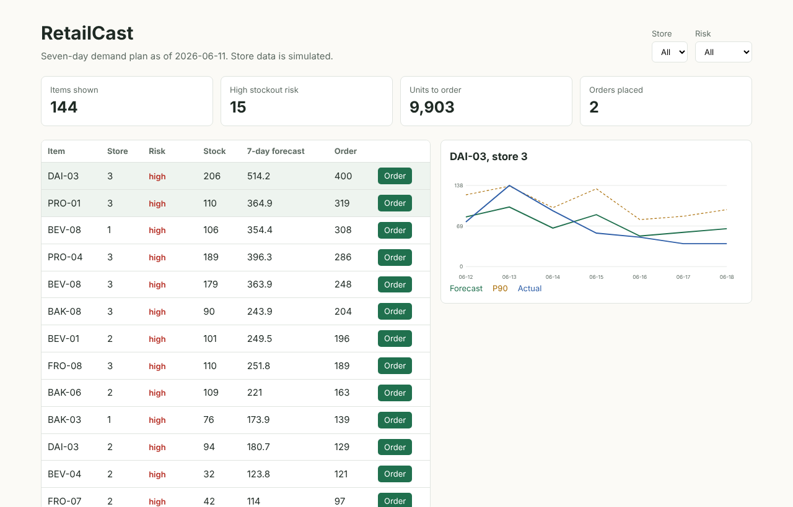

# RetailCast: demand forecasting and reorder dashboard


A full-stack tool that forecasts seven days of demand per store and item, flags stockout risk, recommends order quantities and records orders.

> **Store data is simulated.** Accuracy on a real store has not been measured.



## Results
Six rolling seven-day backtests across 144 store-item series. Full numbers are in [`reports/backtest.json`](reports/backtest.json).

| Metric | LightGBM | Seasonal naive |
|---|---:|---:|
| Daily WAPE (lower is better) | 31.8% | 46.7% |

That is a 32% lower error than the baseline. The P90 upper bound covered 88.7% of days, close to its 90% target.

Daily item-level demand in the simulator is deliberately noisy, which limits how low WAPE can go.

## Run it
```bash
pip install -r requirements-dev.txt
make check   # Python and frontend tests (run npm ci in frontend first)
make web     # build the dashboard
make serve   # http://localhost:8000
```
Or with Docker:
```bash
docker build -t retailcast . && docker run -p 8000:8000 retailcast
```

## Development lifecycle
| Stage | Where |
|---|---|
| Requirements | [docs/requirements.md](docs/requirements.md) |
| Design and decisions | [docs/design.md](docs/design.md), [docs/adr](docs/adr) |
| Testing | [docs/test-plan.md](docs/test-plan.md), [tests](tests), [frontend tests](frontend/src/chart.test.js) |
| CI/CD | [.github/workflows/ci.yml](.github/workflows/ci.yml), [Dockerfile](Dockerfile) |
| Operations | [docs/runbook.md](docs/runbook.md) |

## How this was built

Built with AI assistance (Claude). Commit messages credit it as co-author. I reviewed the design and can explain the tradeoffs.
