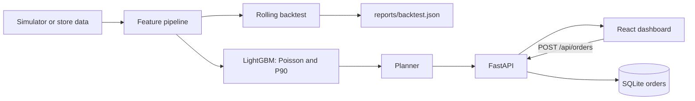

# Design

## Forecasting
- Poisson objective for the expected demand, and quantile objective for the P90.
- All lag features are at least seven days old, so they exist at forecast time.
- Stockout days are removed from features and training, because their sales understate demand.

## Backtesting
Six rolling seven-day folds. Each trains only on earlier dates and scores against true demand. The baseline repeats the sales from one week earlier.

## Planner
Order up to the seven-day forecast plus safety stock. Daily P90 margins combine in quadrature because errors across days partly cancel. Risk is high if stock will not cover the three-day lead time, and medium if it will not cover the week.

## Serving
The API builds a forecast snapshot at start-up from the saved models. The final week was held out of training, so the dashboard's forecast-against-actual view is honest.
